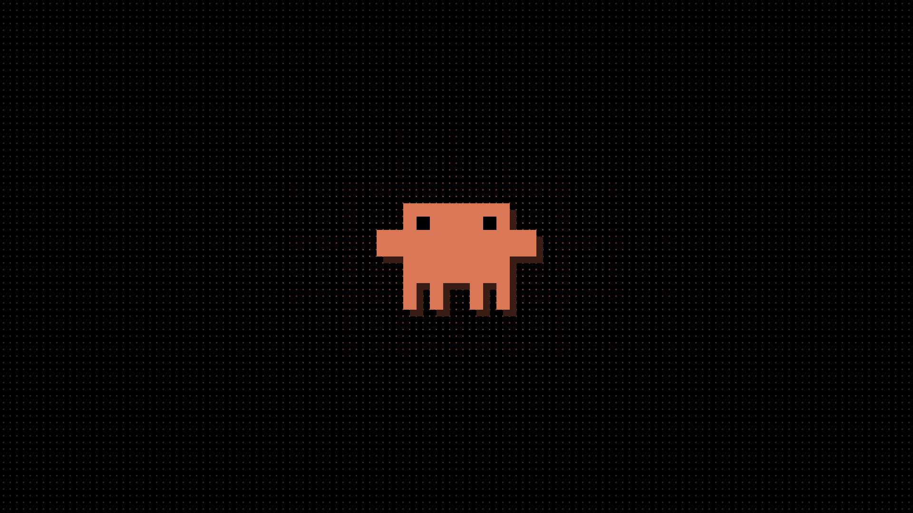
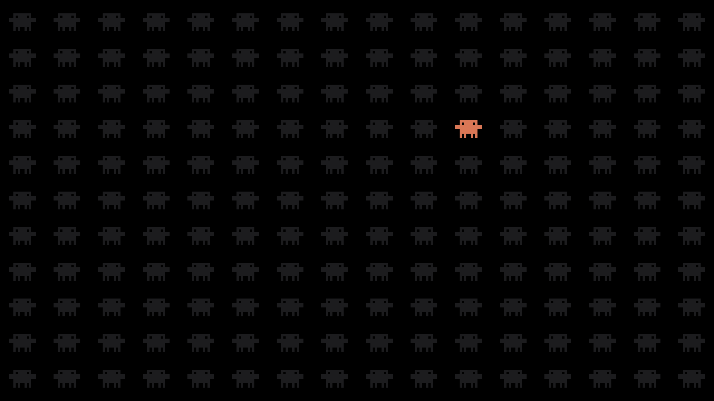
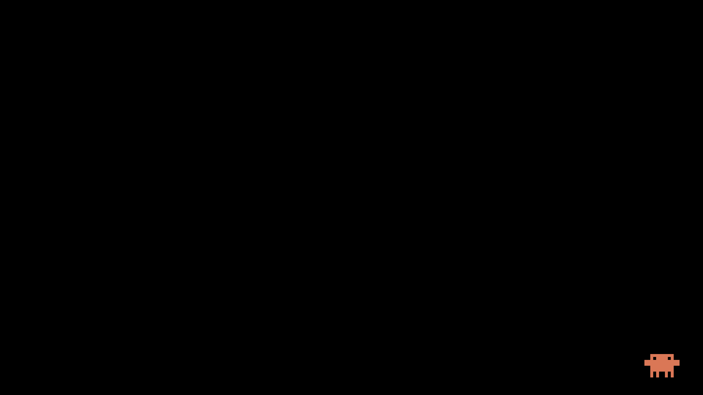
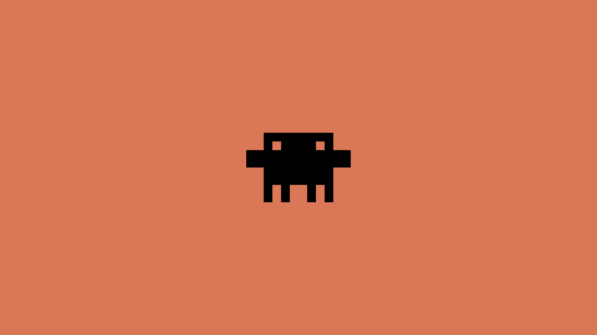

<div align="center">



# clawdots

**Black. Flat. One orange accent.**
A [Hyprland](https://hypr.land) (Lua config) desktop with a [Quickshell](https://quickshell.org) bar,
and a little crab-ish friend named Clawd who lives on your screen.


</div>

---

## ✦ Highlights

| | |
|---|---|
| 🖤 **Look** | Pure black, flat, a single orange (`#da7756`). Dimmed unfocused windows, soft orange glow. |
| 🌀 **Motion** | Springy window pop-in, sliding workspaces, an orange border gradient that slowly rotates around the focused window. |
| 📊 **Bar** | Quickshell bar with now-playing, workspaces, tray, and popups for cpu / mem / vol / net / calendar. |
| 🚀 **Launcher** | `SUPER+space` app search with a built-in calculator, try `2^10` or `15% 80`. |
| 🔔 **Notifications** | Native notification daemon, toasts, volume OSD, do-not-disturb. |
| 🔒 **Lock & idle** | hyprlock with clock + Clawd. Locks after 5 min, screens off after 6. |
| 🎬 **Capture** | `bin/shot` screenshots, `bin/rec` screen recording (wf-recorder, NVENC). |

## 🦀 Meet Clawd

Clawd is everywhere:

- **In the bar**: blinks, hops when you switch workspace, runs when the CPU is busy.
- **On the desktop** (`pet/`): walks along the bottom of the screen and across the tops of windows,
  jumps up onto windows, falls when they close, hops on workspace switch, shouts `!` at new windows,
  and falls asleep (`z z z`) after 40 s of quiet. Toggle with `SUPER+SHIFT+P`.
- **On the lockscreen** and in a bunch of wallpapers.

## 🖼 Wallpapers

`wallpaper/make.py` renders the set: `clawd`, `-plain`, `-inverted`, `-corner`, `-army`, plus `clawd-lock.png`.

<div align="center">



</div>

Pick one with `SUPER+SHIFT+W` or `bin/wall <image>` (remembered via `wallpaper/current`).
The picker also lists `~/Pictures/Wallpapers` and `~/Pictures/wallpapers`.

## 📦 What's inside

```
hypr/         hyprland.lua, hyprlock, hypridle, hyprpaper
quickshell/   bar, launcher, notifications, OSD, popups
pet/          clawd-pet.py, the desktop pet
bin/          shot, rec, wall
ghostty/ kitty/ fuzzel/   matching terminals and dmenu
wallpaper/    generated wallpapers + make.py
waybar/       legacy fallback bar (not started)
install.sh    symlink installer
```

## 🚀 Install

```sh
git clone https://github.com/MishaSklyar/clawdots ~/clawdots
cd ~/clawdots
./install.sh
```

The installer symlinks configs into `~/.config`, backs up anything already there
(`*.bak-<date>`), and lists missing packages. Safe to re-run.

> **Note:** paths assume the repo lives at `~/clawdots`.

**Needs:** `hyprland` `quickshell` `hyprpaper` `hyprlock` `hypridle` `ghostty` `fuzzel` `grim` `slurp`
`wl-clipboard` `cliphist` `libnotify` `playerctl` `wireplumber` `python` `python-gobject` `python-cairo`
`gtk4-layer-shell` `wf-recorder` `ffmpeg` `polkit-gnome` `ttf-jetbrains-mono`

## ⌨ Keys

| keys | action |
|---|---|
| `SUPER+Return` | ghostty |
| `SUPER+space` | app search |
| `SUPER+E` | nautilus |
| `SUPER+V` | clipboard history |
| `SUPER+SHIFT+W` | wallpaper picker (arrows / `hl` browse, enter set, esc close) |
| hold `SUPER` + mouse into bottom-right corner | claude menu: claude.ai, claude code in wezterm, Claude app (`1`-`3` or arrows + enter) |
| `Print` / `SUPER+SHIFT+S` | screenshot region (copied + saved to `~/Pictures/Screenshots`) |
| `SHIFT+Print` | screenshot whole screen |
| `SUPER+R` / `SUPER+SHIFT+R` / `SUPER+ALT+R` | record region / screen / screen + desktop audio (press again, or click `rec` in the bar, to stop; saved to `~/Videos/Screencasts`) |
| `SUPER+N` / `SUPER+SHIFT+N` | clear notifications / toggle do-not-disturb |
| `SUPER+Q` / `SUPER+SHIFT+Q` | close window / force kill it |
| `SUPER+F` / `SUPER+SHIFT+F` | maximize / fullscreen |
| `SUPER+SHIFT+T` | float |
| `SUPER+T` | flip split direction |
| `SUPER+C` | center floating window |
| `SUPER+arrows` or `hjkl` | focus |
| `SUPER+SHIFT+arrows` or `hjkl` | move window |
| `SUPER+CTRL+arrows` or `hjkl` | resize |
| `SUPER+drag` (left / right button) | move / resize |
| `SUPER+1..0` / `SUPER+SHIFT+1..0` | workspace / send window to workspace |
| `SUPER+scroll`, `SUPER+PgUp/PgDn` | previous / next workspace |
| `SUPER+grave` / `SUPER+SHIFT+grave` | scratchpad / send to scratchpad |
| `SUPER+W`, `SUPER+[` `]` | group windows as tabs, flip tabs |
| `ALT+Tab` | cycle windows |
| `ALT+SHIFT` | switch keyboard layout (us / ru) |
| `SUPER+ALT+L` | lock (also relaunches hyprlock on the "lockscreen died" screen) |
| `SUPER+CTRL+ALT+L` | summon the "lockscreen died" screen on purpose (`SUPER+ALT+L` to recover) |
| `SUPER+SHIFT+P` | pet on / off |
| `SUPER+SHIFT+E` | quit Hyprland |

Bar: click now-playing to play/pause (right-click next, middle previous), scroll over workspaces to switch, scroll over `vol` to change volume, click the clock for a calendar,
click the layout tag to switch layout, right-click tray icons for their menu.
